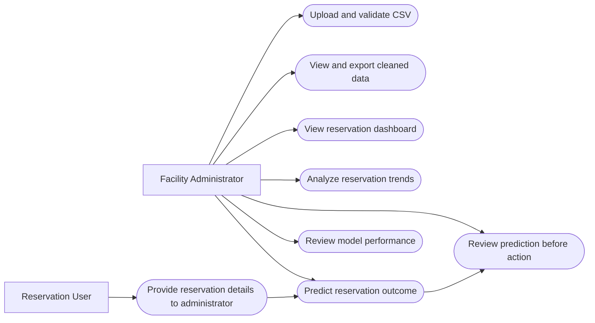
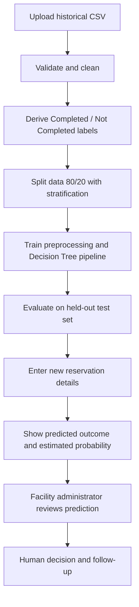

# Required Submission — Campus Facility Reservation and Monitoring System

## 1. Links (complete after publishing)
- GitHub repository URL: **PENDING — paste actual GitHub link**
- Deployed Streamlit URL: **PENDING — paste actual Streamlit link**

## 2. Original and revised files
- `original_midterm.ipynb`: original supplied midterm notebook, unchanged
- `app.py`: Streamlit application with five modules
- `requirements.txt`: deployment dependencies
- `README.md`: setup and deployment instructions
- `SUBMISSION.md`: submission report and updated requirements

## 3. Screenshots and five sample predictions
**PENDING SCREENSHOTS:** Screenshots must be taken from the actual running app. Capture: `01_dashboard.png`, `02_data_management.png`, `03_data_analysis.png`, `04_prediction.png`, `05_model_evaluation.png`. On the Prediction page, show the table titled **Five sample predictions from uploaded records** and download `five_sample_predictions.csv`. Five sample predictions from the provided workbook have been generated in `five_sample_predictions.csv`.

## 4. Updated functional requirements
- **FR-01 Upload:** The administrator can upload a CSV; the system checks required columns and reports errors.
- **FR-02 Clean:** The system standardizes categories, marks invalid values missing, removes exact duplicates, derives lead-time and reservation outcome fields, and allows CSV export.
- **FR-03 Monitor:** The dashboard displays historical totals and observed Completed / Not Completed / Unknown counts.
- **FR-04 Analyze:** The system displays reservation distributions and observed outcomes by facility, user category, purpose, and lead-time category.
- **FR-05 Predict:** The administrator enters nine pre-reservation predictors and receives a Decision Tree prediction and estimated probability.
- **FR-06 Evaluate:** The system displays held-out accuracy, precision, recall, F1 and confusion matrix.
- **FR-07 Review:** Predictions are decision-support only; the administrator reviews cases before taking action.

### Use case diagram (Mermaid source)

### Decision-support workflow

## 5. Short deployment report
**Reused code:** Preserved the notebook's required input columns, cleaning logic, lead-time categories, outcome mapping (Used → Completed; Cancelled/No-Show → Not Completed), nine non-leaking predictors, 80/20 stratified split, and Decision Tree settings (`max_depth=5`, `min_samples_leaf=5`, `class_weight='balanced'`, `random_state=42`).

**Changes:** Replaced Colab uploads, print outputs, and static Matplotlib dashboard with a Streamlit CSV uploader, five navigable modules, interactive prediction form, charts, downloadable CSV files, model metrics, and clearer error messages. The original notebook is included separately.

**Tests:** Static Python syntax check completed during preparation. Dataset conversion and offline model evaluation completed using the provided Excel workbook (360 cleaned records; 72 test records). Metrics: Accuracy=0.653, Precision (Not Completed)=0.545, Recall (Not Completed)=0.444, F1 (Not Completed)=0.490. Five predictions are saved in `five_sample_predictions.csv`. Live Streamlit UI, screenshots, GitHub publishing, and deployment are not yet verified.

**Limitations:** Predictions depend on the quality and representativeness of uploaded historical data. Unknown or missing labels cannot be used for training. Small datasets may prevent stratified evaluation. Model probabilities are not calibrated. There is no login, live reservation database, automated booking, or real-time facility status. The uploaded CSV is processed in the app session and cached for model fitting; do not upload sensitive records to a public deployment without suitable controls.

**Reflection:** The Streamlit conversion makes the notebook easier to use for facility administrators by combining data cleaning, historical monitoring, predictions, and evaluation in one interface. Model predictions should support—not replace—administrator judgment.
